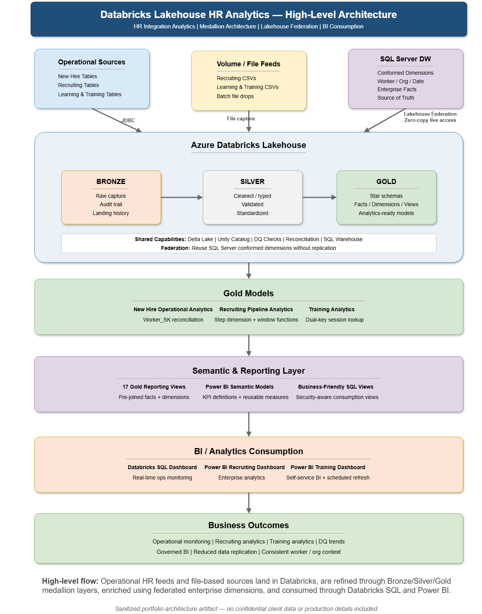
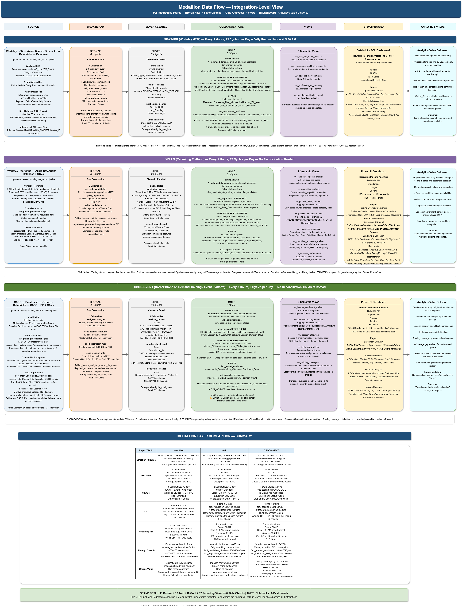
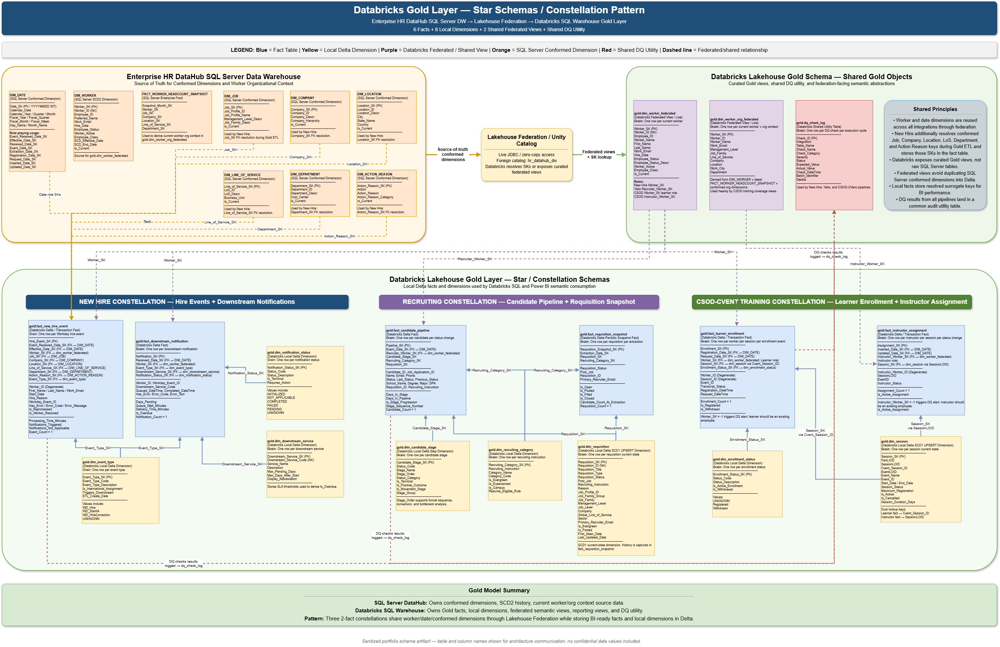
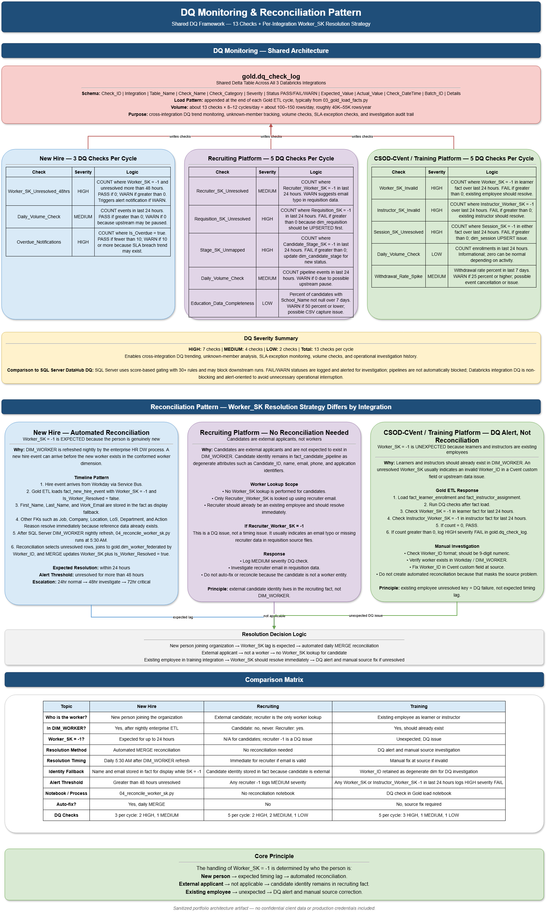

# Databricks Lakehouse HR Analytics — Medallion Architecture Blueprint

## Overview
This repository contains a personal architecture blueprint for building HR integration analytics on Azure Databricks using Medallion Architecture, Delta Lake, Lakehouse Federation, Gold-layer dimensional models, data quality checks, reconciliation patterns, semantic views, and BI consumption design.

The design demonstrates how Databricks can extend an existing enterprise HR DataHub by creating integration-specific analytics layers while reusing conformed dimensions through Lakehouse Federation instead of replicating enterprise data.

This is a sanitized portfolio artifact created to demonstrate lakehouse architecture, data engineering, data modeling, governance, and analytics consumption design. It is not client documentation and does not include proprietary data, production code, credentials, internal system names, or real employee/customer data.

## Architecture Principles

1. Conformed dimensions remain in the enterprise DataHub.
2. Databricks accesses shared dimensions through Lakehouse Federation.
3. Integration-specific dimensions live locally in Delta Lake.
4. Facts stay local to where data originates.
5. Avoid unnecessary data replication.
6. Use Databricks SQL for operational users and Power BI for enterprise users.
7. Build dimensional models where analytical value exists.
8. Skip dimensional modeling where the use case is purely operational.
9. Use Gold-layer views as semantic-ready consumption objects.
10. Treat data quality and reconciliation as first-class architecture components.

## Architecture Diagrams

| Diagram | Description |
|---|---|
| [High-Level Architecture](diagrams/databricks-lakehouse-high-level-architecture.png) | Source-to-consumption view of Databricks Lakehouse HR analytics. |
| [End-to-End Architecture — Detailed View](diagrams/databricks-lakehouse-end-to-end-architecture-detailed.png) | Detailed architecture showing sources, federation, Medallion layers, Gold models, DQ, semantic views, and BI consumption. |
| [Medallion Data Flow](diagrams/medallion-data-flow-integration-view.png) | Integration-level Source → Bronze → Silver → Gold → Views → BI flow. |
| [Lakehouse Federation Pattern](diagrams/lakehouse-federation-pattern.png) | Zero-copy access to SQL Server conformed dimensions through Lakehouse Federation. |
| [Gold Layer Models](diagrams/databricks-gold-layer-star-schemas.png) | Gold-layer star schemas / constellation models for New Hire, Recruiting, and Training analytics. |
| [DQ Monitoring & Reconciliation Pattern](diagrams/dq-monitoring-reconciliation-pattern.png) | Shared DQ framework and Worker_SK resolution strategy by integration. |
| [BI Consumption Pattern](diagrams/bi-consumption-pattern.png) | Power BI vs Databricks SQL consumption design by audience, latency, RLS, and refresh needs. |
| [Enterprise HR Hybrid Analytics Landscape](diagrams/enterprise-hr-hybird-analytics-landscape.png) | Side-by-side comparison of SQL Server HR DataHub and Azure Databricks analytics platforms. |

## High-Level Architecture

The high-level architecture shows how Azure Databricks extends an enterprise HR DataHub for integration-specific analytics. Operational sources and file feeds are captured into Bronze, standardized in Silver, modeled in Gold, enriched through Lakehouse Federation with enterprise conformed dimensions from SQL Server, and consumed through Databricks SQL and Power BI.

## End-to-End Lakehouse Architecture — Detailed View

[View Detailed Lakehouse Architecture](diagrams/databricks-lakehouse-end-to-end-architecture-detailed.png)

This detailed architecture view shows the full Databricks Lakehouse analytics lifecycle from operational sources and file feeds through Bronze/Silver/Gold layers, Lakehouse Federation, shared DQ utilities, semantic reporting views, orchestration patterns, BI consumption through Databricks SQL and Power BI, operational controls, and business outcomes.

For detailed explanation, see [End-to-End Lakehouse Architecture](documentation/end-to-end-lakehouse-architecture.md).

## Medallion Data Flow

This diagram shows how Medallion Architecture is applied across three HR integration analytics domains: New Hire, Recruiting, and Training. Each integration follows the Source → Bronze → Silver → Gold → Reporting Views → BI pattern while applying different ingestion methods, transformation logic, Gold-layer modeling patterns, DQ/reconciliation controls, and BI consumption designs.

For detailed explanation, see [Medallion Data Flow](documentation/medallion-data-flow.md).

## Lakehouse Federation Pattern

This diagram shows how Azure Databricks accesses enterprise conformed HR dimensions from SQL Server through Unity Catalog Lakehouse Federation without copying them into Delta Lake. 
Federated Gold views provide reusable worker identity and organization context, while integration-specific facts and dimensions remain local in Databricks. The SQL Server HR DataHub remains the source of truth, while Databricks exposes governed Gold-layer semantic views for integration analytics without persistently replicating conformed dimensions into Delta Lake.

For detailed explanation, see [Lakehouse Federation Pattern](documentation/lakehouse-federation-pattern.md).

## Gold Layer Models

This diagram shows the Databricks Gold-layer dimensional models for New Hire, Recruiting, and Training analytics. Each integration is modeled as a focussed constellation pattern with local facts and dimensions, while shared worker and organization context is reused through Lakehouse Federation from the enterprise SQL Server DataHub.

For detailed explanation, see [Gold Layer Modeling](documentation/gold-layer-modeling.md).

## Data Quality & Reconciliation Pattern

This diagram shows the shared data quality monitoring and Worker_SK resolution strategy across New Hire, Recruiting, and Training analytics. A shared Gold-layer DQ log captures integration-specific checks, while unresolved worker keys are handled differently based on business context: automated reconciliation for newly hired workers, no reconciliation for external candidates, and DQ alerts for existing employees.

For detailed explanation, see [Data Quality & Reconciliation](documentation/data-quality-and-reconciliation.md).

## BI Consumption Pattern

This diagram shows how SQL Server and Databricks Gold-layer models are consumed through Power BI and Databricks SQL. It compares enterprise workforce Power BI dashboards, Databricks-powered Recruiting and Training analytics, and a real-time Databricks SQL operational dashboard. The design uses the right BI tool based on audience size, refresh needs, RLS requirements, visual complexity, and operational latency.

For detailed explanation, see [BI Consumption Pattern](documentation/bi-consumption-pattern.md).

## Enterprise HR Hybrid Analytics Landscape

[View Enterprise HR Hybrid Analytics Landscape](diagrams/enterprise-hr-hybird-analytics-landscape.png)

This detailed reference landscape compares the SQL Server HR DataHub and Azure Databricks Lakehouse analytics platforms side by side. It shows how Kimball-based workforce analytics and Medallion-based integration analytics coexist through Lakehouse Federation, shared conformed dimensions, semantic views, Power BI, Databricks SQL, data quality controls, and cross-platform refresh orchestration.

This diagram is intentionally detailed and is provided as a reference architecture artifact.

---

## Detailed Documentation

| Document | Description |
|---|---|
| [End-to-End Lakehouse Architecture](documentation/end-to-end-lakehouse-architecture.md) | Explains the full Databricks lakehouse lifecycle from sources to BI outcomes. |
| [Medallion Data Flow](documentation/medallion-data-flow.md) | Explains Bronze, Silver, Gold, reporting views, and BI flow across integrations. |
| [Lakehouse Federation Pattern](documentation/lakehouse-federation-pattern.md) | Explains zero-copy conformed dimension access using Unity Catalog Federation. |
| [Gold Layer Modeling](documentation/gold-layer-modeling.md) | Explains Gold-layer facts, dimensions, federated views, and constellation patterns. |
| [Data Quality and Reconciliation](documentation/data-quality-and-reconciliation.md) | Explains shared DQ logging and Worker_SK resolution patterns. |
| [BI Consumption Pattern](documentation/bi-consumption-pattern.md) | Explains Power BI and Databricks SQL dashboard consumption patterns. |

---

## What This Demonstrates

- Azure Databricks Lakehouse architecture
- Medallion Architecture: Bronze, Silver, Gold
- Delta Lake data modeling
- Lakehouse Federation with SQL Server
- Gold-layer dimensional modeling
- Star schema / constellation design
- Shared conformed dimensions
- Data quality monitoring
- Reconciliation patterns
- Semantic/reporting views
- Power BI and Databricks SQL consumption
- BI refresh and audience-based tool selection
- Hybrid SQL Server DataHub + Databricks analytics design

---

## Confidentiality Note

This repository contains only sanitized, generic architecture and data modeling artifacts created for portfolio purposes. It does not include proprietary client documentation, confidential data, internal system names, credentials, production code, or real employee/customer data.

---

## Author

**Sri Adilakshmi Marrivada**  
Lead Consultant | Data Platform Architect | 19+ Years Experience  
[LinkedIn Profile](https://www.linkedin.com/in/sri-adilakshmi-marrivada)
