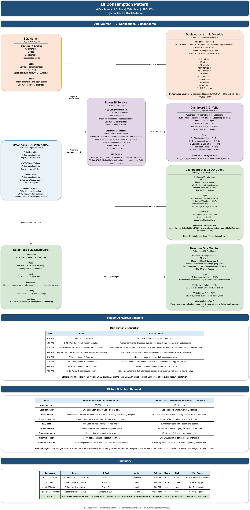

# BI Consumption Pattern

## Overview

This document explains the BI consumption design for the Databricks Lakehouse HR Analytics platform.

The architecture supports two primary BI consumption patterns:

1. **Power BI** for enterprise analytics, large user groups, governed dashboards, RLS, and advanced visuals.
2. **Databricks SQL Dashboard** for small operational teams that need near-real-time monitoring directly on the lakehouse.

The guiding principle is:

> Use the right BI tool for the right audience, latency requirement, security model, and consumption pattern.

This is a sanitized portfolio artifact created to demonstrate BI architecture, semantic consumption, lakehouse analytics, Power BI, Databricks SQL, and dashboard design thinking. It is not client documentation and does not include proprietary data, production code, credentials, internal system names, or real employee/customer data.

---

## Architecture Diagram



---

## Consumption Architecture

The platform supports dashboard consumption from two analytical platforms:

### SQL Server HR DataHub

Used for enterprise workforce analytics such as:

- Headcount
- Attrition
- Transfer
- Performance
- Leave / LOA
- Hours
- Compensation
- Planning
- Retiree
- Partner
- Data quality scorecard

The Power BI model connects to SQL Server using a composite model pattern:

- Import mode for dimensions and aggregation tables
- DirectQuery for very large fact tables
- Heavy DAX for time intelligence, rolling calculations, and cross-fact measures
- Row-level security for enterprise user segmentation

### Databricks Lakehouse

Used for integration-specific analytics such as:

- Recruiting pipeline analytics
- Training enrollment analytics
- New hire operational monitoring

The Databricks-powered Power BI dashboards consume Gold reporting views through the native Databricks connector.

Pattern:

- Gold facts and dimensions are modeled in Delta Lake
- Gold reporting views pre-join facts and dimensions
- Most business logic is pre-modeled in SQL views
- Power BI imports reporting views on a scheduled basis
- Minimal DAX is required in Power BI

---

## Power BI Service Pattern

Power BI is used for enterprise analytics and broader business audiences.

### SQL Server Connection

Representative pattern:

```text
Power BI Service
HR Analytics Workspace

SQL Server Connection
- Native SQL Server connector
- Mode: Composite
- Import for dimensions and aggregation tables
- DirectQuery for large fact tables
- Refresh: Daily scheduled refresh
```

Why this pattern is used:

- Dimensions and aggregations are fast and efficient in Import mode.
- Large facts can remain in DirectQuery to avoid very large import models.
- Aggregation tables improve dashboard performance.
- Composite models balance performance and detail-level drill-through.
- RLS supports large enterprise user populations.

---

### Databricks Connection

Representative pattern:

```text
Power BI Service
HR Analytics Workspace

Databricks Connection
- Native Databricks connector
- Databricks-powered dashboards import Gold reporting views
- Most business logic is pre-modeled in SQL views
- Mode: Import with scheduled refresh
- Recruiting refresh: Daily scheduled refresh
- Training refresh: Daily scheduled refresh
```

Why this pattern is used:

- Power BI users already consume enterprise analytics in Power BI.
- Gold reporting views simplify the semantic model.
- Most calculations are pre-computed in SQL views.
- Scheduled refresh is sufficient for recruiting and training analytics.
- Import mode reduces repeated Databricks SQL Warehouse queries.
- Power BI supports familiar visuals, governance, sharing, and RLS patterns.

---

## DAX Pattern

The DAX design differs by source platform.

### DataHub Dashboards

DataHub dashboards require heavier DAX because they consume a broader dimensional warehouse model.

Examples:

- Time intelligence
- Rolling averages
- Year-over-year metrics
- Cross-fact calculations
- RLS-aware measures
- Executive KPI calculations

### Databricks-Powered Dashboards

Databricks-powered dashboards use minimal DAX because most business logic is pre-modeled in Gold reporting views.

Examples:

- Pipeline conversion rates
- Candidate stage progressions
- Enrollment summaries
- Session utilization
- Training coverage
- SLA summaries
- Daily volume metrics

This keeps the Power BI model simpler and pushes reusable transformation logic into the governed Gold reporting layer.

---

## Databricks SQL Dashboard Pattern

Databricks SQL Dashboard is used for near-real-time operational monitoring.

Representative pattern:

```text
Databricks SQL Dashboard
- Source: Gold reporting views
- Mode: Live SQL execution
- No imported BI dataset
- Refresh: Query executes on dashboard interaction
- Audience: Small operational team
- RLS: Not required where all users see the same operational dataset
```

Why this pattern is used:

- The audience is small and technical.
- Users already work in Databricks.
- Operational monitoring benefits from live SQL execution.
- No separate Power BI dataset refresh is required.
- Dashboards can query the same Gold views used by the ETL/analytics layer.
- It avoids unnecessary tool switching for the operations team.

---

## Dashboard Domains

## 1. Enterprise Workforce Analytics

Tool:

```text
Power BI
```

Source:

```text
SQL Server HR DataHub
```

Audience:

- HR business partners
- People analytics
- Finance / FP&A
- Compensation
- Diversity and inclusion
- HR leadership
- Executives

Representative dashboards:

- Headcount
- Attrition
- Transfer
- Performance
- Leave / LOA
- Hours
- Compensation
- Planning
- Retiree
- Partner
- DQ scorecard

Consumption pattern:

- Composite model
- Import dimensions and aggregation tables
- DirectQuery for large facts
- Heavy DAX
- Enterprise RLS

---

## 2. Recruiting Pipeline Analytics

Tool:

```text
Power BI
```

Source:

```text
Databricks Gold reporting views
```

Audience:

- Recruiters
- Talent acquisition leadership
- HR leadership

Representative dashboard pages:

- Pipeline overview
- Conversion and drop-off
- Candidate and education analytics
- Requisition health
- Recruiter performance

Consumption pattern:

- Import mode
- Gold reporting views
- Minimal DAX
- Scheduled refresh
- Recruiter-level RLS

---

## 3. Training Enrollment Analytics

Tool:

```text
Power BI
```

Source:

```text
Databricks Gold reporting views
```

Audience:

- Learning and development teams
- HR leadership
- Training program owners

Representative dashboard pages:

- Enrollment overview
- Session utilization
- Instructor analytics
- Training coverage

Consumption pattern:

- Import mode
- Gold reporting views
- Minimal DAX
- Scheduled refresh
- No RLS where all approved users see the same training dataset

---

## 4. New Hire Operations Monitor

Tool:

```text
Databricks SQL Dashboard
```

Source:

```text
Databricks Gold reporting views
```

Audience:

- Integration operations team
- Data engineering / support users

Representative dashboard pages:

- Operations overview
- Hire event detail
- Notification SLA monitoring

Consumption pattern:

- Live SQL execution
- No imported BI dataset
- Near-real-time monitoring
- Small operational audience
- No RLS where all approved users see the same operational dataset

---

## Staggered Refresh Strategy

Power BI refreshes are staggered to avoid resource contention and align with upstream data availability.

Representative sequence:

| Time | Event | Purpose |
|---|---|---|
| Early AM | SQL Server warehouse ETL completes | Enterprise DataHub becomes ready |
| 5:30 AM | Enterprise workforce Power BI refresh | Refreshes DataHub dashboards |
| 5:30 AM | New Hire reconciliation | Resolves worker keys after warehouse refresh |
| 6:00 AM | Recruiting Power BI refresh | Imports Databricks Gold recruiting views |
| 6:30 AM | Training Power BI refresh | Imports Databricks Gold training views |
| 7:00 AM | Business dashboards current | Business users have refreshed dashboards |

Why staggered refresh matters:

- Avoids SQL Warehouse contention
- Prevents multiple large BI refreshes from competing for compute
- Ensures worker dimension refresh is complete before reconciliation
- Ensures enterprise dashboards are ready before business day
- Allows downstream Databricks-powered dashboards to refresh after Gold views are ready

---

## BI Tool Selection Rationale

| Factor | Power BI | Databricks SQL Dashboard |
|---|---|---|
| Audience size | Medium to large business user groups | Small operational/technical team |
| User familiarity | Enterprise users already use Power BI | Ops users already work in Databricks |
| Refresh need | Daily refresh is usually sufficient | Near-real-time visibility needed |
| Visual complexity | Advanced visuals, slicers, drilldowns, RLS | Simple KPIs, tables, operational charts |
| RLS need | Strong RLS support | Used when RLS is not required or simpler |
| Data movement | Imported or composite semantic models | Live SQL execution against lakehouse views |
| Query pattern | Cached dataset for many users | Direct SQL queries for small audience |
| Federation impact | Usually during scheduled refresh | May occur during live query depending on view |
| Best fit | Enterprise BI and self-service analytics | Operational monitoring and technical dashboards |

---

## Design Principles

1. Use Power BI for broad enterprise analytics and governed self-service.
2. Use Databricks SQL Dashboard for small operational teams needing live monitoring.
3. Pre-model business logic in Gold reporting views where possible.
4. Keep DAX minimal for Databricks-powered dashboards.
5. Use composite models when balancing large fact tables and fast dimensions.
6. Use import mode when scheduled refresh is sufficient and user concurrency is high.
7. Use DirectQuery only where detail-level freshness or large fact access requires it.
8. Stagger refreshes to avoid compute contention.
9. Align dashboard refresh timing with upstream ETL completion.
10. Choose BI tooling based on audience, latency, security, and operational needs.

---

## Confidentiality Note

This document is a sanitized portfolio artifact created for data architecture demonstration purposes. It does not include proprietary client documentation, confidential data, production code, credentials, internal system names, or real employee/customer data.

