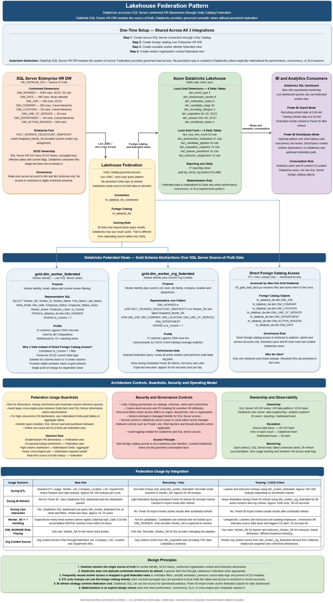

# Lakehouse Federation Pattern

## Overview

This document explains how Azure Databricks uses Lakehouse Federation to access conformed dimensions from an enterprise SQL Server HR Data Warehouse without persistently replicating those dimensions into Delta Lake.

The key design principle is:

> Keep enterprise conformed dimensions in the SQL Server HR DataHub as the source of truth, and access them from Databricks through governed federated views when needed.

This pattern allows Databricks to build integration-specific lakehouse analytics while preserving consistent worker, organization, date, job, company, location, department, and Line of Service context from the enterprise warehouse.

This is a sanitized portfolio artifact created to demonstrate lakehouse architecture and federation design thinking. It is not client documentation and does not include proprietary data, production code, credentials, internal system names, or real employee/customer data.

---

## Architecture Diagram



---

## Why Lakehouse Federation Is Used

Without federation, Databricks would need to replicate key enterprise dimensions such as worker, job, company, location, department, Line of Service, and date into Delta Lake.

That would create several problems:

- Duplicate copies of conformed dimensions
- Potential synchronization lag
- Additional data movement
- Additional reconciliation overhead
- Higher governance complexity
- Risk of inconsistent worker or organization context
- More operational maintenance

Lakehouse Federation avoids these problems by allowing Databricks to query approved SQL Server objects live through a governed connection.

---

## Important Distinction: Federation vs Replication

Lakehouse Federation provides governed read access to external data.

It does **not** mean that SQL Server tables are copied into Delta Lake by default.

However, BI tools or query engines may still cache or import results depending on the consumption pattern.

Examples:

- Power BI Import mode may cache data inside the Power BI dataset.
- Databricks SQL may use result caching.
- Temporary query results may be materialized by the engine.
- Explicit materialization may be used for performance, concurrency, or SLA reasons.

This is different from replicating source-of-truth dimension tables into Delta Lake as managed tables.

---

## One-Time Setup Pattern

The federation setup follows four logical steps:

1. Create a secure SQL Server connection through Unity Catalog.
2. Create a foreign catalog over the enterprise HR Data Warehouse.
3. Create a reusable worker identity federated view.
4. Create a reusable worker organization context federated view.

Credentials are managed through a secure secret manager or Databricks secret scope. Credentials are not stored directly in notebooks, SQL scripts, or documentation.

---

## SQL Server HR DataHub Role

The SQL Server HR DataHub remains the enterprise source of truth for conformed dimensions and enterprise workforce facts.

Representative conformed dimensions include:

- Worker
- Date
- Job
- Company
- Location
- Department
- Line of Service
- Action Reason

Representative enterprise facts include:

- Worker headcount snapshot
- Worker event facts
- Leave facts
- Hours facts
- Compensation-related facts
- Planning facts

The SQL Server warehouse manages:

- SCD2 versioning
- Surrogate keys
- Conformed dimensions
- Enterprise fact tables
- Security tiers
- Audit and DQ metadata

Databricks consumes only approved objects through federation and does not directly access restricted or highly restricted schemas unless explicitly authorized.

---

## Federated View 1: Worker Identity

### View

```text
gold.dim_worker_federated
```

### Purpose

Provides a clean worker identity view for Databricks Gold models.

It filters the enterprise worker dimension to current worker records and exposes only the attributes needed for integration analytics.

### Representative Attributes

- Worker surrogate key
- Worker business identifier
- Worker name
- First name
- Last name
- Work email
- Hire date
- Employee status
- Worker active flag
- Employee class

### Used By

- New Hire operational analytics
- Recruiting analytics
- Training enrollment analytics
- Gold reporting views
- Worker key resolution
- Recruiter lookup
- Learner / instructor lookup

### Why a Federated View Is Used

A federated Gold view is used instead of direct foreign catalog access because:

- Multiple downstream views reference the same worker identity pattern.
- Current-row filtering is centralized.
- Only approved columns are exposed.
- The view gives a stable semantic name in the Gold schema.
- Downstream models are insulated from foreign catalog path changes.
- SCD2 misuse is reduced by enforcing `Is_Current = 1` centrally.

---

## Federated View 2: Worker Organization Context

### View

```text
gold.dim_worker_org_federated
```

### Purpose

Provides worker identity plus current organization context.

This view combines worker identity with the latest headcount snapshot and conformed organization dimensions.

### Representative Attributes

- Worker surrogate key
- Worker business identifier
- Worker name
- Work email
- Management level
- Job family
- Line of Service
- Company
- Location
- Department

### Used By

Primarily used by Training analytics, especially training coverage and workforce slicing use cases.

Example business questions:

- Which worker groups have completed required training?
- What is training coverage by Line of Service?
- What is training coverage by level, location, company, or department?
- Which organizational groups have learning coverage gaps?

### Performance Consideration

This view is heavier than the worker identity view because it joins worker records to the latest headcount snapshot and multiple conformed organization dimensions.

Therefore, it should be used intentionally:

- Suitable for scheduled dashboard refresh.
- Suitable for coverage analysis.
- Not ideal for frequent ad hoc queries without filtering.
- Can be materialized only when performance, concurrency, or SLA requirements justify it.

---

## Direct Foreign Catalog Access

Not every federated dimension requires a Gold federated view.

Some dimensions are accessed directly at ETL time for surrogate key resolution.

Representative examples:

- Job
- Company
- Location
- Line of Service
- Department
- Action Reason
- Date

### Pattern

1. Gold ETL notebook queries approved foreign catalog dimensions.
2. Surrogate keys are resolved during fact loading.
3. Resolved surrogate keys are stored in Gold fact tables.
4. Dashboards query Gold facts or reporting views.
5. Foreign dimensions are not queried at dashboard time unless needed.

### Why No View Is Needed

A separate Gold view may not be needed when:

- Only one ETL notebook uses the object.
- The fact table stores resolved surrogate keys.
- Dashboards do not directly query the source dimension.
- The access pattern is stable and controlled.
- Reusable semantic abstraction is not required.

---

## Local vs Federated Object Ownership

The lakehouse uses a clear ownership model.

### Federated / Enterprise-Owned

Conformed enterprise dimensions remain in SQL Server:

- Worker
- Date
- Job
- Company
- Location
- Line of Service
- Department
- Action Reason

### Local / Integration-Owned

Integration-specific dimensions live locally in Delta Lake:

- Event type
- Downstream service
- Notification status
- Candidate stage
- Recruiting category
- Requisition
- Session
- Enrollment status

### Local Facts

Facts stay local to the platform where the data originates:

- New Hire event facts remain in Databricks.
- Recruiting pipeline facts remain in Databricks.
- Training enrollment facts remain in Databricks.
- Existing enterprise workforce facts remain in SQL Server.

This avoids unnecessary cross-platform data movement.

---

## Federation Usage by Integration

| Usage Area | New Hire | Recruiting | Training |
|---|---|---|---|
| Primary federated usage | Worker identity and multiple conformed dimension lookups | Recruiter identity lookup | Learner/instructor identity and worker org context |
| Worker role-playing | Hired worker | Recruiter | Learner and instructor |
| Organization context | Resolved from federated dimensions during fact load | Requisition-local context | Worker org context from federated view |
| Reconciliation | Yes, for newly hired workers | No, candidates are external | No, unresolved workers become DQ alerts |
| Dashboard-time federation | Databricks SQL may query worker view live | Power BI uses imported refresh | Power BI refresh uses worker org view |
| Main concern | Timing delay before worker appears in enterprise dimension | Recruiter should resolve | Learner/instructor should already exist |

---

## Worker Key Handling

Different integrations handle unresolved worker keys differently.

### New Hire

Newly hired workers may not yet exist in the enterprise worker dimension.

Pattern:

1. Temporary unresolved worker key is allowed.
2. Fallback identity attributes are stored for display.
3. Daily reconciliation updates unresolved keys after dimension refresh.
4. Records unresolved beyond threshold become DQ alerts.

### Recruiting

Candidates are external applicants and are not expected to exist in the enterprise worker dimension.

Pattern:

1. Candidate identity is modeled separately.
2. Recruiter identity resolves through the worker dimension.
3. Unresolved recruiter keys are treated as DQ issues.
4. Candidate-worker reconciliation is intentionally not required.

### Training

Learners and instructors are expected to be existing workers.

Pattern:

1. Unresolved worker keys are not timing issues.
2. They indicate source data quality problems.
3. DQ alerts are generated for investigation.
4. Automatic reconciliation is not applied.

---

## Federation Guardrails

Federation should be used intentionally, not as a default replacement for physical modeling.

### Best Fit

Federation is best suited for:

- Conformed dimensions
- Lookup enrichment
- Moderate-volume reference queries
- Shared semantic objects
- Worker identity and organization context

### Avoid or Limit

Federation should be avoided or limited for:

- High-concurrency dashboard queries
- Large unfiltered scans
- Repeated interactive exploration without caching
- Complex cross-source joins at user-click time
- SLA-critical dashboards with heavy query patterns

### Design Guidance

- Use federated views for reusable semantic access.
- Use direct foreign catalog access for controlled ETL-time lookups.
- Resolve and store surrogate keys in fact tables when possible.
- Avoid dashboard-time federation if resolved keys and local facts can serve the use case.
- Materialize only when performance, concurrency, or SLA needs justify it.

---

## Security and Governance Controls

Lakehouse Federation must follow enterprise security and governance standards.

Representative controls include:

- Unity Catalog permissions on catalogs, schemas, views, and connections
- Column-level security and masking where applicable
- Row-level filters where required
- Read-only service account for approved schemas
- No access to restricted or highly restricted schemas unless explicitly authorized
- Secrets managed through Databricks secret scope or cloud-native secret manager
- Network controls such as private link or VNet injection where applicable
- Audit logging for Databricks and SQL Server access
- Access reviews for sensitive views and connections

---

## Observability and Operations

Federated access should be monitored to avoid performance and reliability issues.

Recommended monitoring areas:

- Query latency
- Failed connection attempts
- SQL Server load
- SQL Warehouse performance
- BI refresh success/failure
- Access errors
- Federation query volume
- Cache effectiveness
- DQ check status
- SLA impact

If federation queries become too expensive or unreliable, the design decision should be revisited and materialization may be considered.

---

## Design Principles

1. SQL Server HR DataHub remains the source of truth for conformed dimensions.
2. Databricks does not replicate conformed dimensions by default.
3. Federated views provide governed semantic access.
4. Direct foreign catalog access is used only where a reusable view is not needed.
5. Local dimensions live in Delta Lake when they are integration-specific.
6. Facts stay local to the platform where the data originates.
7. Worker and organization context are reused consistently across integrations.
8. Dashboard-time federation is minimized unless the use case requires live access.
9. Materialization is an explicit design choice, not the default.
10. Federation usage is governed by performance, security, concurrency, and SLA requirements.

---

## Confidentiality Note

This document is a sanitized portfolio artifact created for data architecture demonstration purposes. It does not include proprietary client documentation, confidential data, production code, credentials, internal system names, server names, secret names, or real employee/customer data.